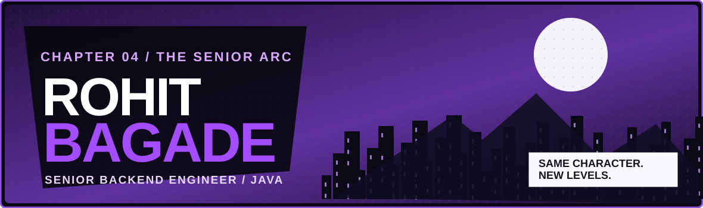
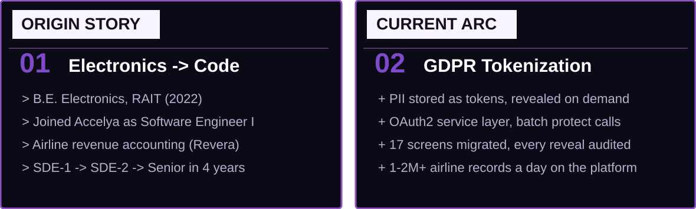
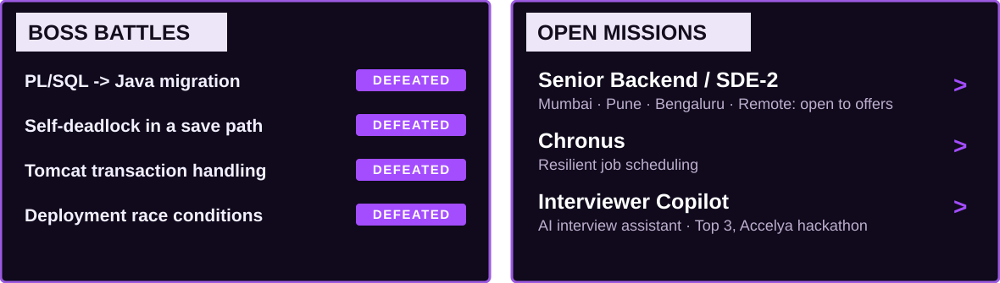

**Senior Backend Engineer at Accelya: airline revenue accounting, Java microservices, GDPR tokenization.**

### POWER STACK · Gear unlocked

| Backend / Data | Cloud / Tools / AI |
|:--|:--|
| Java 17 · Spring Boot · Hibernate · REST · Microservices · Kafka | AWS Lambda · Docker · Tomcat · Linux · GitHub Actions · Git |
| Oracle · PL/SQL · PostgreSQL · MySQL · Redis · MongoDB | Python · JavaScript / TypeScript · React · LLM integrations |

### SIDE QUESTS · Explore the source

| Quest | Objective | Portal |
|:--|:--|:--|
| **Chronus** | Job scheduler: recurring jobs over REST, exponential-backoff retries, immutable audit log, JWT + RBAC | [Repo](https://github.com/RohitBagade/Chronus) · [Live API](https://chronos-scheduler-api.fly.dev/health) |
| **Interviewer Copilot** 🏆 | Live interview transcription + LLM answer analysis · Top 3, Accelya internal hackathon (Feb 2026) | [Repo](https://github.com/RohitBagade/interviewer-copilot) |
| **APEX** | E-commerce: server-side re-pricing, money as integer paise, Stripe test checkout, admin dashboard | [Repo](https://github.com/RohitBagade/ProteinEcomSite) · [Live](https://frontend-drab-seven-89.vercel.app) |
| **CalorieCounter.ai** | Plain-English meal → calories + macros with structured LLM output | [Repo](https://github.com/RohitBagade/CalorieCounter.ai) · [Live](https://caloriecounter-ai-rohit-bagades-projects.vercel.app) |

### CONTRIBUTION ARC

<b>⚔️ Expand the build log</b>

- **Enterprise:** Revera, an airline revenue-accounting platform handling ~1–2M+ transaction records a day; 4–5 legacy PL/SQL services migrated to Java microservices (selected workloads on AWS Lambda); Java 8 → 17, JBoss → standalone Tomcat.
- **Current arc:** leading GDPR tokenization. PII stored as tokens and revealed only on demand through an external API, with an audit event for every reveal. Shared OAuth2 service layer, 17 menu screens migrated.
- **Side quests:** backend systems that design for failure: schedulers with backoff, idempotent pipelines, multi-provider LLM failover.

IT'S A LONG GAME. AND I'M JUST GETTING STARTED.

